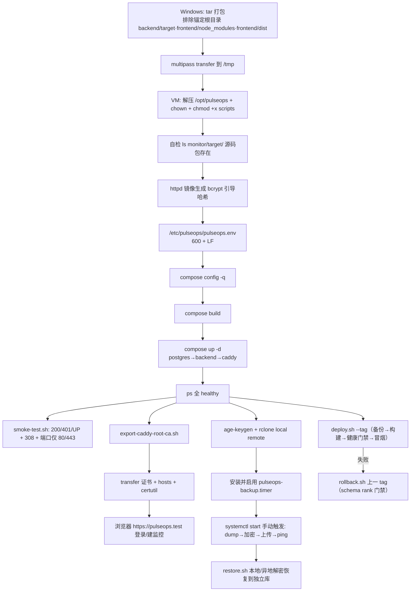

# Phase 5A 本地部署运行手册（当前工程 → Multipass VM → Windows 访问）

## 用途与边界

- 本文件是**可照做的部署运行手册**：把当前仓库代码部署到本地 Multipass 虚拟机 `pulseops-vps`，并从 Windows 宿主机通过 HTTPS 访问。
- VM 的安装与基础配置见 [`phase5a-vm-setup.md`](phase5a-vm-setup.md)；行为与规范的**事实来源**是 [`../quality/deployment.md`](../quality/deployment.md)，设计决策见 [`phase5a-deployment.md`](phase5a-deployment.md)，已验收的实际执行证据见 [`../quality/phase5a-acceptance.md`](../quality/phase5a-acceptance.md)。
- 范围仅限本地演练（5A）：真实域名证书、公网可达性、外部监控注册与连续运行验收属 Phase 5B。

## 生产路径约定

| 用途 | 路径 | 要求 |
|---|---|---|
| 代码 | `/opt/pulseops` | 属主为部署账号 |
| 环境文件 | `/etc/pulseops/pulseops.env` | **600 且 LF 行尾** |
| age 私钥 | `/etc/pulseops/age.key` | 600，不进 Git |
| rclone 配置 | `/etc/pulseops/rclone.conf` | 600，不进 Git |
| 本地备份 | `/var/backups/pulseops` | 仅属主可访问 |
| 异地副本（5A 用本地 remote） | `/var/backups/pulseops-offsite` | 仅属主可访问 |

## 前置条件

- VM `pulseops-vps` 处于 Running，且已执行 `sudo scripts/provision-vm.sh`：Docker Engine + Compose v2、ufw、age、rclone、jq 就绪，Docker 镜像加速已配置，时区 UTC。
- 当前登录用户已在 `docker` 组并已重新登录（`docker version` 无需 sudo）。

## 步骤 0：打包源码并送入 VM（本手册的踩坑点）

Windows 自带的 `tar.exe`（bsdtar）中 `*` **可跨 `/` 匹配**。排除规则必须**锚定到根目录产物**：

```powershell
cd G:\work\workspace\2026\PulseOps
git rev-parse --short HEAD          # 记下输出，步骤 9 的 --tag 会用到

tar -czf pulseops-src.tar.gz `
  --exclude "backend/target" `
  --exclude "frontend/node_modules" `
  --exclude "frontend/dist" `
  --exclude "backups" --exclude ".git" `
  backend frontend compose.prod.yaml deploy scripts

multipass transfer pulseops-src.tar.gz pulseops-vps:/tmp/pulseops-src.tar.gz
```

- 必须包含：`backend/`、`frontend/`（含各自 `Dockerfile`、`src`、`frontend/deploy/Caddyfile`）、`compose.prod.yaml`、`deploy/`（含 `env.prod.example` 与 `systemd/`）、`scripts/`。
- **禁止**写 `--exclude "*/target"` 或 `--exclude "*/dist"`。后端存在源码包 `backend/src/main/java/dev/pulseops/monitor/target/`，跨层级模式会把它从 tar 包里删掉，构建时报 `package dev.pulseops.monitor.target does not exist`。
- `backend/.dockerignore` 里的裸 `target/` **不是**上述故障的原因：Docker 的 `.dockerignore` 模式只相对构建上下文根匹配，不会删除嵌套的同名源码目录。要改动它请先按步骤 1 的自检确认，不要盲目加 `!` 反向放行（目录被排除后其内容通常无法再重新包含）。

## 步骤 1：VM 内解压到生产路径

```bash
sudo mkdir -p /opt/pulseops
sudo tar -xzf /tmp/pulseops-src.tar.gz -C /opt/pulseops
sudo chown -R ubuntu:ubuntu /opt/pulseops
chmod +x /opt/pulseops/scripts/*.sh          # tar 跨平台不保留执行位，手动补

# 决定性自检：必须列出 target 源码包下的 .java 文件
ls /opt/pulseops/backend/src/main/java/dev/pulseops/monitor/target/
```

## 步骤 2：生成引导管理员密码哈希

首次启动且 `app_user` 为空时，应用用 `PULSEOPS_AUTH_BOOTSTRAP_PASSWORD_HASH` 建号，格式必须为 `{bcrypt}$2...`（成本 12，密码 12–128 字符）：

```bash
docker run --rm httpd:2.4-alpine \
  htpasswd -bnBC 12 '' 'your-strong-password' | cut -d: -f2 | tr -d '\n'; echo
```

把输出前加 `{bcrypt}`，例如 `{bcrypt}$2y$12$...`。规则见 [`../specs/auth.md`](../specs/auth.md)。

## 步骤 3：准备生产环境文件

```bash
sudo install -d -m 755 /etc/pulseops
sudo cp /opt/pulseops/deploy/env.prod.example /etc/pulseops/pulseops.env
sudo chown ubuntu:ubuntu /etc/pulseops/pulseops.env
sudo chmod 600 /etc/pulseops/pulseops.env
sudo sed -i 's/\r$//' /etc/pulseops/pulseops.env    # 必须 LF；CRLF 会被 deploy.sh 拒绝
nano /etc/pulseops/pulseops.env
```

按 `deploy/env.prod.example` 填写，关键项：

```dotenv
POSTGRES_PASSWORD='用单引号包住，防 $ 被 Compose 展开'
PULSEOPS_AUTH_BOOTSTRAP_USERNAME=admin
PULSEOPS_AUTH_BOOTSTRAP_PASSWORD_HASH='{bcrypt}$2y$12$步骤2生成的哈希'

SITE_ADDRESS=pulseops.test        # 5A 本地域名；5B 改真实域名
TLS_ISSUER=internal               # 5A 内部 CA；5B 改 ACME 邮箱
IMAGE_TAG=local                   # 首次手动构建用 local；后续发布由 deploy.sh 的 --tag 决定

COMPOSE_FILE=/opt/pulseops/compose.prod.yaml
COMPOSE_PROJECT_NAME=pulseops
```

- `DB_URL` 保持模板默认；仅在「schema 不兼容恢复」时指向恢复库。
- 备份相关变量在步骤 7 配置；`AGE_RECIPIENT`/`BACKUP_RCLONE_REMOTE`/`BACKUP_RCLONE_PATH` 三者不齐时只做本地备份。
- `PULSEOPS_TELEGRAM_BOT_TOKEN`/`_CHAT_ID` 留空即不启用 Telegram 通知。

## 步骤 4：首次启动生产栈

**首次必须手动启动**：`deploy.sh` 会在构建前先执行一次备份，全新 VM 上栈尚未运行、备份必然失败，脚本会在构建前中止。

```bash
cd /opt/pulseops
export EF=/etc/pulseops/pulseops.env
docker compose --env-file $EF -f compose.prod.yaml config -q    # 配置校验
docker compose --env-file $EF -f compose.prod.yaml build        # VM 本地 Maven/npm 编译
docker compose --env-file $EF -f compose.prod.yaml up -d        # 启动
docker compose --env-file $EF -f compose.prod.yaml ps           # 等三个服务 healthy
```

依赖健康链：postgres → backend → caddy；仅 caddy 发布 80/443。backend `start_period=60s`，首次约 1–2 分钟才转 healthy 属正常。

## 步骤 5：VM 内验证

用仓库自带的冒烟脚本（与 `deploy.sh`、`rollback.sh` 同一套判据）：

```bash
cd /opt/pulseops
export EF=/etc/pulseops/pulseops.env
./scripts/smoke-test.sh --url https://pulseops.test \
  --resolve pulseops.test:443:127.0.0.1 --insecure
# 期望：Smoke test passed: root=200 anonymous_monitors=401 health=UP

curl -sI --resolve pulseops.test:80:127.0.0.1 http://pulseops.test/ | head -1   # 308 跳 HTTPS
docker compose --env-file $EF -f compose.prod.yaml port                          # 只应出现 80/443
docker compose --env-file $EF -f compose.prod.yaml exec caddy \
  caddy validate --config /etc/caddy/Caddyfile                                   # Valid configuration
```

## 步骤 6：Windows 宿主机用浏览器访问

```bash
# VM 内导出 Caddy 内部根 CA（公钥证书；私钥始终留在 caddy-data 卷）
cd /opt/pulseops
COMPOSE_ENV_FILE=/etc/pulseops/pulseops.env \
  ./scripts/export-caddy-root-ca.sh /home/ubuntu/caddy-root.crt
```

```powershell
# 取回证书
multipass transfer pulseops-vps:/home/ubuntu/caddy-root.crt G:\work\workspace\2026\PulseOps\

# 管理员 PowerShell：写入 hosts（VM 重启后 IP 会变，需重跑）
$ip = (multipass info pulseops-vps --format json | ConvertFrom-Json).info.'pulseops-vps'.ipv4[0]
$h  = "$env:SystemRoot\System32\drivers\etc\hosts"
Set-Content $h ((Get-Content $h) | Where-Object { $_ -notmatch '\spulseops\.test$' }) -Encoding ASCII
Add-Content $h "$ip pulseops.test" -Encoding ASCII
ipconfig /flushdns

# 普通 PowerShell：导入当前用户信任库
certutil -user -addstore Root .\caddy-root.crt
```

浏览器打开 `https://pulseops.test`，用步骤 2 的用户名/明文密码登录，验证创建监控与查看历史，会话 Cookie 带 `Secure`。证书移除与 Firefox 差异见 [`../quality/deployment.md`](../quality/deployment.md)「本地 HTTPS 演练」。

## 步骤 7：备份加密、异地与定时调度

`backup.sh` 在 `AGE_RECIPIENT`、`BACKUP_RCLONE_REMOTE`、`BACKUP_RCLONE_PATH` 齐全时自动执行「本地 dump → 自检 → age 加密 → rclone 上传 → 校验远端大小 → 异地保留 → ping Healthchecks」。

```bash
# 1) age 密钥（把输出里的 PUBLIC key 填入环境文件的 AGE_RECIPIENT）
sudo age-keygen -o /etc/pulseops/age.key
sudo chmod 600 /etc/pulseops/age.key

# 2) rclone 本地 remote（5A 用目录模拟对象存储）
sudo mkdir -p /var/backups/pulseops /var/backups/pulseops-offsite
sudo install -m 600 /dev/null /etc/pulseops/rclone.conf
sudo tee -a /etc/pulseops/rclone.conf > /dev/null <<'EOF'
[local]
type = local
EOF
```

环境文件补充：

```dotenv
BACKUP_DIR=/var/backups/pulseops
BACKUP_RETENTION_COUNT=7
BACKUP_OFFSITE_RETENTION_COUNT=14
AGE_RECIPIENT=age1...（步骤1的公钥）
BACKUP_RCLONE_REMOTE=local
BACKUP_RCLONE_PATH=/var/backups/pulseops-offsite/pulseops/db
RCLONE_CONFIG=/etc/pulseops/rclone.conf
HEALTHCHECKS_PING_URL=          # 留空跳过 ping；5B 填真实成功 URL
```

安装并启用调度：

```bash
cd /opt/pulseops
sudo install -m 0644 deploy/systemd/pulseops-backup.service \
                   deploy/systemd/pulseops-backup.timer \
                   deploy/systemd/pulseops-backup-failure.service /etc/systemd/system/
sudo systemctl daemon-reload
sudo systemctl enable --now pulseops-backup.timer
systemctl list-timers pulseops-backup.timer          # OnCalendar 03:17 UTC, Persistent

sudo systemctl start pulseops-backup.service          # 手动触发一次
journalctl -u pulseops-backup.service -n 50 --no-pager
```

期望日志包含 `Verified remote object: ...dump.age`、`Retained local backups ... 7/7`、`Backup complete.`；失败时 `OnFailure` 单元 ping `/fail`。

## 步骤 8：恢复演练

```bash
cd /opt/pulseops
export COMPOSE_FILE=/opt/pulseops/compose.prod.yaml COMPOSE_PROJECT_NAME=pulseops

# 本地副本 → 独立库
./scripts/restore.sh ./backups/pulseops-<时间戳>.dump pulseops_restore

# 异地加密副本 → 独立库
sudo rclone --config /etc/pulseops/rclone.conf \
  copyto "local:/var/backups/pulseops-offsite/pulseops/db/<file>.dump.age" /tmp/latest.dump.age
sudo age --decrypt --identity /etc/pulseops/age.key \
  --output /tmp/latest.dump /tmp/latest.dump.age
sudo ./scripts/restore.sh /tmp/latest.dump pulseops_restore
```

- 脚本拒绝恢复进源库与维护库；目标库已存在需显式 `--force`（不可撤销）。
- 校验 Flyway 历史与核心表行数与源库一致后，再按 [`../quality/deployment.md`](../quality/deployment.md) 用恢复库启动应用验证健康与管理 API。
- 演练结束删除恢复库与临时文件；`age.key` 权限必须保持 600。

## 步骤 9：后续发布与回滚

`deploy.sh` 要求 **root 运行、环境文件 600 且 LF、磁盘余量 ≥ 2 GiB、栈已在运行**（构建前要备份）。打包传输的目录没有 `.git`，无法自动推断 tag，**必须显式 `--tag`**（用步骤 0 记录的 Git short SHA）。

```bash
cd /opt/pulseops
export PULSEOPS_ENV_FILE=/etc/pulseops/pulseops.env

sudo ./scripts/deploy.sh --dry-run --tag <short-sha>   # 只打印计划
sudo ./scripts/deploy.sh --tag <short-sha>             # 备份→构建→启动→健康门禁→冒烟→清理
```

失败时脚本**不自动回滚**，只打印回滚命令；状态写入 `.deployed-tag`、`.previous-tag`、`.deployed-tags/<tag>.schema`。回滚：

```bash
sudo ./scripts/rollback.sh --dry-run          # 缺省使用 .previous-tag
sudo ./scripts/rollback.sh <previous-tag>
```

- 目标 tag 的 schema rank 低于当前库、或缺少 schema 元数据时脚本拒绝执行；此时按 [`../quality/deployment.md`](../quality/deployment.md)「Schema 不兼容时的恢复流程」处理（恢复备份到新库 → 改 `DB_URL` → 再回滚），切换 `DB_URL` 不可逆。
- 若改用 `git clone` 方式部署到 VM，可省略 `--tag`，脚本会用 `git rev-parse --short HEAD`。

## 步骤 10：防火墙与 SSH 加固演练（可选）

仅 5A 在 VM 内验证幂等性与规则生效；真实 VPS 上的执行属 5B。**禁止在 Windows 宿主或 WSL2 运行**。

加固前先打快照（Windows 宿主，恢复用 `multipass restore pulseops-vps.pre-harden`）：

```powershell
multipass stop pulseops-vps
multipass snapshot pulseops-vps --name pre-harden
multipass start pulseops-vps
```

VM 内执行：

```bash
cd /opt/pulseops
sudo ./scripts/harden-vps.sh --dry-run
sudo ./scripts/harden-vps.sh
sudo ufw status verbose
sudo sshd -T | grep -E '^(port|maxauthtries|permitrootlogin|passwordauthentication|kbdinteractiveauthentication|pubkeyauthentication) '
```

- 脚本会 `ufw --force reset` 后只保留 22(limit)/80/443；不要在有其他 ufw 规则的主机运行。
- 保留当前会话，另开一个会话确认密钥登录成功后再断开。连续快速 SSH 会触发 `limit 22` 速率限制，属预期。
- 从 Windows 宿主确认仅 22/80/443 可达，5432/8080 不可达（Docker 发布端口会绕过 ufw，本项目只发布 80/443）。

## 步骤 11：重启验证

```powershell
multipass restart pulseops-vps
multipass info pulseops-vps          # IP 可能变化，重跑步骤 6 的 hosts 片段
```

VM 内确认：

```bash
systemctl is-system-running
cd /opt/pulseops && docker compose --env-file /etc/pulseops/pulseops.env -f compose.prod.yaml ps
systemctl list-timers pulseops-backup.timer --all
```

三服务应按 `restart: unless-stopped` 自动恢复 healthy，timer 仍为 enabled；随后重跑 `smoke-test.sh` 确认结果与重启前一致。

## 部署流程图



## 常见坑

- 打包排除用 `*/target` → 源码包丢失，构建报 `package dev.pulseops.monitor.target does not exist`（见步骤 0）。
- 环境文件带 CRLF → `deploy.sh` 直接拒绝，`sed -i 's/\r$//'` 修正。
- 全新 VM 直接跑 `deploy.sh` → 构建前备份失败而中止；首次先用步骤 4 手动启动。
- VM 重启后 IP 变化 → hosts 与所有 `--resolve` 都要用当次 IP。
- 连续快速 SSH 触发 ufw `limit 22` 短暂不可达；443 与容器不受影响。
- `IMAGE_TAG` 在 `build` 与 `up` 必须一致，否则起的是不存在的镜像并转去 registry 拉取。
